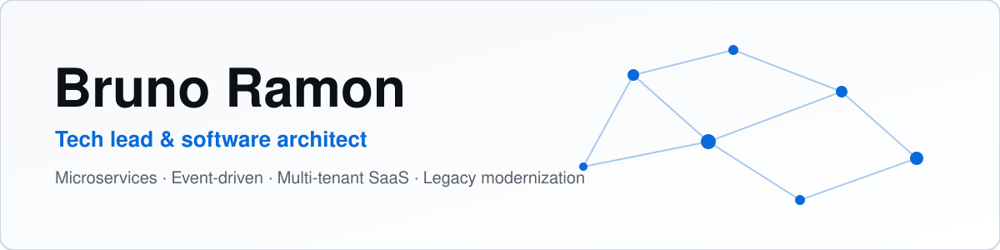

<picture>
  <source media="(prefers-color-scheme: dark)" srcset="assets/banner-dark.svg">
  
</picture>

### Tech lead & software architect. I build and modernize backend systems, and I write down what I learn along the way.

I'm Bruno, a tech lead and software architect based in Curitiba, Brazil. I work on Java and Spring Boot microservices, event-driven architectures, multi-tenant SaaS and legacy modernization. The problems I enjoy most are the ones where the system is already in production and has to keep running while it changes. For those, I prefer incremental migrations (strangler pattern) over big-bang rewrites.

## Things I write and talk about

- **Event-driven architecture**: Kafka, Debezium and the Outbox pattern, end to end
- **Multi-tenancy**: SaaS isolation with PostgreSQL Row-Level Security
- **Legacy modernization**: strangler pattern, anti-corruption layers, migrating without downtime
- **Identity and access management**: Keycloak, OAuth2/OIDC and service-to-service security
- **Applied AI in the backend**: LLM gateways with Spring AI, guardrails, observability and cost control

## Currently exploring

- Practical LLM integration in Java backends, beyond the demo
- Coding agents as part of the everyday development workflow
- Resilience and failure-mode testing for microservices

## Stack

**Backend**

**Data & messaging**

**Infra & security**

**Frontend**

## How I think about architecture

1. **Migrate in slices.** Every step should be reversible, and the old path keeps working until the new one has earned trust.
2. **Get the boundaries right before picking tools.** Ownership and domain edges come first. Kafka or REST is a later decision.
3. **Design for operation.** Observability, failure modes and on-call cost are part of the design, not an afterthought.

## Outside of work

I produced music for bands, taught computer classes for kids and adults, and I still play more games than I should.

## Latest posts

<!-- Feed source: [URL DO FEED] -->
<!-- BLOG-POST-LIST:START -->
_Posts will show up here once the RSS feed is connected._
<!-- BLOG-POST-LIST:END -->

## Stats

<picture>
  <source media="(prefers-color-scheme: dark)" srcset="https://github-readme-stats.vercel.app/api?username=djbrunoramon&show_icons=true&hide_border=true&theme=transparent&title_color=e6edf3&icon_color=2f81f7&text_color=9da7b3">
  
</picture>

## Let's talk

Disagree with a pattern, found a flaw in one of my examples, or want to compare notes on a migration? Open an [issue](https://github.com/djbrunoramon/djbrunoramon/issues) or start a [discussion](https://github.com/djbrunoramon/djbrunoramon/discussions), or reach out on [LinkedIn](https://www.linkedin.com/in/bruno-ramontm/).
